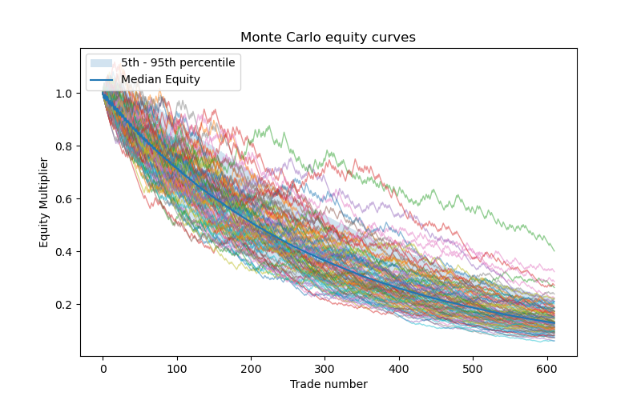
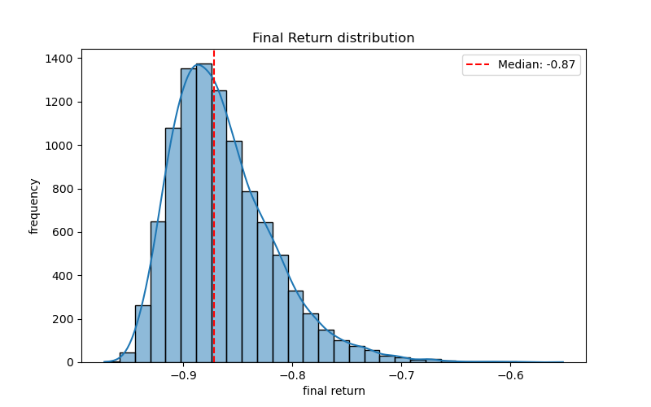
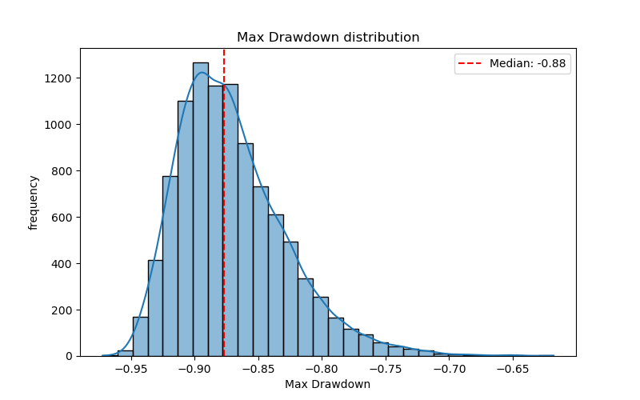

# VWAP Mean-Reversion Strategy (EUR/USD, M5)

Hypothesis: buying or selling when price is overextended and begins to pull back can provide a tradable edge on EUR/USD at the 5-minute timeframe.

An event-driven backtester for an intraday EUR/USD strategy. Overextension is marked by 2σ VWAP band touches, together with losing interest indicated by fading volume, all in the direction of the higher-timeframe momentum. Results are stress-tested with Monte Carlo simulation (bootstrap, trade-order shuffle and a significance test on mean R).

Summary of findings: Net of costs, the strategy has negative expectancy: -0.33R per trade over 610 trades (95% CI [-0.43, -0.22]; one-sided p ≈ 1.0 against a positive edge). Cumulative R never turned positive over the full test period.


## Strategy

Data: EUR/USD, 5-minute bars from Dukascopy, 2022-01-01 to 2026-07-01.

Indicators
- VWAP: reset daily at 17:00 New York time (the FX session rollover), with ±2 standard-deviation bands.
- Volume fade: the highest-volume bar in the last 20 bars had more than 1.5× the current bar's volume, and the current close sits below (long) or above (short) that bar's close.
- Higher-timeframe momentum: sign of the 4-bar change on 1-hour closes.
- ATR(14) for stop placement.

Entry (long; short is the mirror image)
1. Higher-timeframe momentum is up.
2. Price touched the lower band within the last 2 bars.
3. Volume-fade condition is met.
4. The previous close was at or above the previous VWAP.

The signal is evaluated on bar t and executed at the open of bar t+1.

Exit
- Stop loss: previous bar's low (long) or high (short) ∓ 1 × ATR.
- Take profit: 2R, where R is the distance from entry to stop.
- Forced close before the weekend gap or at the end of the data.

Trade filters
- No entries in the first 4 bars of a session.
- No entries in the last 8 bars before a weekend gap.
- 2-hour pause after 3 consecutive losing trades.

## Parameters

| Parameter | Value |
|---|---|
| Band width | 2σ |
| Band-touch window | 2 bars |
| Volume look-back / factor | 20 bars / 1.5× |
| Higher-timeframe momentum | 1h closes, 4-bar change |
| ATR window | 14 |
| Stop / target | 1 × ATR beyond previous bar / 2R |
| Loss-streak pause | 2 hours after 3 losses |

All parameters live in `src/config.py`.

## Cost and execution model

| Item | Assumption |
|---|---|
| Spread | 0.5 pip |
| Commission | 0.6 pip round trip |
| Slippage | 0.2 pip on entry, 0.2 pip on exit |
| Gaps | If a bar opens beyond the stop or target, the fill is at the open (plus slippage), not at the level |
| Short side | Exits are checked against the ask (bid + spread) |

All PnL is expressed in R-multiples (profit divided by initial risk), net of costs.

## Avoiding look-ahead bias

- Entry signals are shifted one bar, so trades execute at the next open.
- ATR is lagged one bar.
- The higher-timeframe trend is lagged one bar before being forward-filled onto M5 bars.
- Stops and targets are computed only from information available at signal time.

## Results

| Metric | Value |
|---|---|
| Period | 2022-01-01 to 2026-07-01 |
| Number of trades | 610 |
| Win rate | 28.2% |
| Average R per trade | -0.326 |
| Profit factor | 0.613 |
| Per-trade Sharpe (mean R / std R) | -0.241 |
| Biggest loss (R) | -1.42 |
| Biggest win (R) | 1.96 |
| Cumulative R: minimum / maximum | -207.8 / -1.2 |

### Monte Carlo (10,000 simulations, 1% risk per trade)

| Metric | Value |
|---|---|
| Median final return | -87.2% |
| 5th – 95th percentile return | -92.5% to -77.7% |
| Median max drawdown | -87.7% |
| 95th-percentile worst max drawdown | -92.8% |
| P(loss) | 1.0 |
| P(profit) | 0.0 |
| P(drawdown ≥ 10%) | 1.0 |
| Mean R, 95% CI | [-0.432, -0.218] |
| Bootstrap p-value (H0: mean R ≤ 0) | 1.0 |

### Shuffle test

| Metric | Value |
|---|---|
| Observed max drawdown | -88.2% |
| Shuffled-order max drawdown, worst 5% | -88.6% |
| P(shuffled drawdown at least as bad as observed) | 0.159 |





### Interpretation

1. No positive expectancy. The strategy averaged -0.33R per trade over 610 trades. The 95% bootstrap confidence interval for mean R is [-0.43, -0.22], entirely below zero, and the one-sided p-value against a positive edge is approximately 1.0. Cumulative R peaked at -1.2R, so the strategy was never in net profit.
2. The win rate is too low for the payoff structure. With a 2R target the break-even win rate is 33.3%, and the observed win rate is 28.2%. Even at exactly 2R per win and 1R per loss, expectancy at this win rate is about -0.15R, so the signal itself does not beat random entries. The remaining roughly -0.17R per trade comes from costs and execution, which weigh heavily because the 1 × ATR stop is tight on M5.
3. Position sizing cannot fix this. At 1% risk per trade the median simulated outcome is an 87% loss, every one of the 10,000 paths ends negative, and the 10% ruin level is breached in all of them.
4. The drawdown is structural, not bad luck. The observed maximum drawdown (-88%) is typical of random reorderings of the same trades (P = 0.16), so it comes from the negative expectancy and not from an unlucky sequence.
5. Conclusion. This configuration of 2σ VWAP band touches, volume fading and higher-timeframe momentum does not produce a tradable edge on EUR/USD M5 from January 2022 to mid-2026. The result applies to this configuration and does not rule out other variants of the idea.

## Methodology notes

- Bootstrap: trades are resampled with replacement to build 10,000 alternative equity paths, giving distributions for return and drawdown.
- Shuffle test: trade order is permuted to check whether the observed drawdown is typical for this set of trades.
- Significance test: the mean R is re-centred to zero and bootstrapped to get a one-sided p-value for the observed mean.

## Limitations

- Single instrument and a single timeframe.
- All results are in-sample. Parameters (including the stop and target multiples) were adjusted manually over a small number of runs on the same data, with no systematic search or out-of-sample test. A parameter search or walk-forward test might give different results.
- The bootstrap treats trades as independent. Real trades may cluster by volatility regime.
- Dukascopy tick volume is used as a proxy for real volume, since spot FX has no centralised volume.
- Fixed spread and slippage assumptions. Real spreads widen around news and at rollover.
- Several parameters are counted in bars (volume look-back, band-touch window, session and weekend filters, ATR) and were not rescaled for the M5 timeframe. Costs are fixed in pips, so they weigh more heavily against the small M5 stop distances.

## Project structure

```
main.py              # runs the full pipeline
src/
  config.py          # all parameters
  data.py            # data download and loading
  indicators.py      # VWAP bands, signals, ATR, entries, SL/TP, filters
  backtest.py        # trade simulation
  metrics.py         # performance statistics
  monte_carlo.py     # bootstrap / shuffle / significance tests
  plots.py           # charts
results/             # generated charts
```

## How to run

Requires Python 3.10+ and Node.js (for the data download).

```bash
pip install -r requirements.txt

# download data (writes to download/)
npx dukascopy-node -i eurusd -from 2022-01-01 -to 2026-07-01 -t m5 -f csv -v true

python main.py
```

Parameters can be changed in `src/config.py`. Charts are saved to `results/` and the trade log to `trades.csv`.

## Disclaimer

This project is for quantitative research and education only. It is not financial advice, and backtested performance does not guarantee future results.